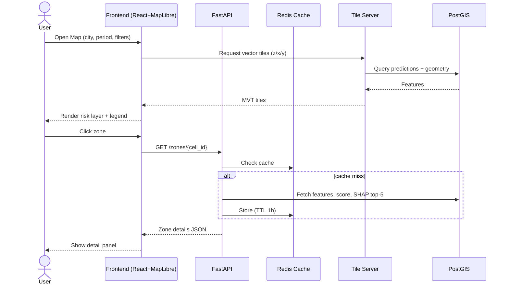
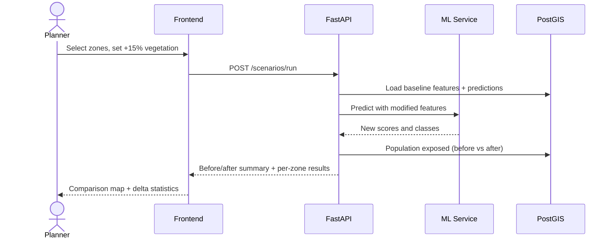
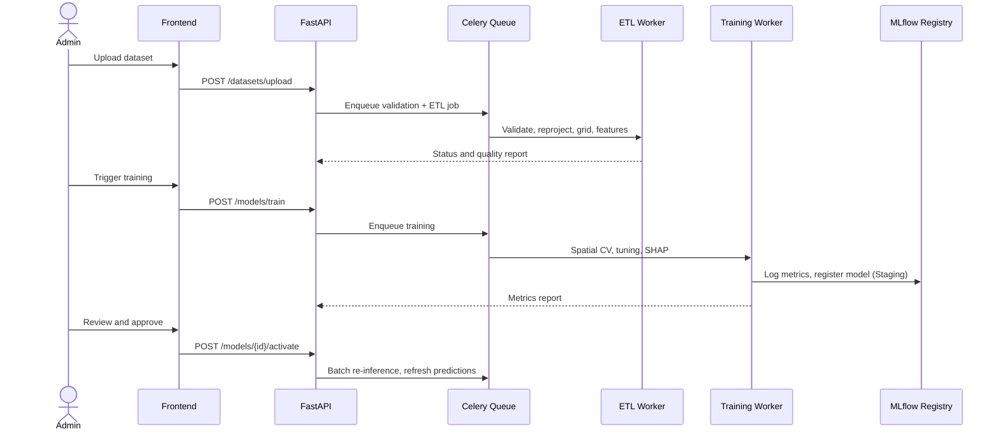

# Product Requirements Document (PRD)

# Urban Heat Risk Prediction and Spatial Mapping Platform


---

## Table of Contents
1. Executive Summary (1A. Stakeholder One-Page Summary)
2. Problem Statement and Opportunity
3. Goals, Non-Goals, Success Metrics
4. Users and Personas
5. User Journeys and Stories
6. Scope and Release Plan
7. Functional Requirements
8. Heat-Risk Methodology
9. Data Requirements and Data Dictionary
10. Machine Learning Specification
11. System Architecture and Tech Stack
12. Database Schema
13. API Specification
14. UX / UI Specification and Wireframes
15. Non-Functional Requirements
16. Security, Privacy, and Ethics
17. Testing and Validation Plan
18. Deployment, Operations, and Maintenance
19. Project Plan, Roles, and Resources
20. Risks and Mitigations
21. Assumptions, Dependencies, Constraints
22. Requirements Traceability Matrix
23. Acceptance Criteria (Definition of Done)
24. Open Questions
25. Future Roadmap
26. Glossary
27. Approvals

**Appendices:** A. Architecture Decision Records • B. Sequence Diagrams • C. Deployment, Capacity, Failure Handling • D. Implementation Readiness Pack • E. Cost Estimate • F. Operations Runbook

---

## 1. Executive Summary

Cities are getting hotter due to rapid urbanization, loss of vegetation, and growth of heat-absorbing infrastructure, which intensifies the **Urban Heat Island (UHI)** effect. Authorities currently lack a unified, data-driven tool to see *where* heat risk is highest, *why*, and *what to do about it*.

The **Urban Heat Risk Prediction and Spatial Mapping Platform** uses **XGBoost** to predict heat-risk levels across city grid cells or wards, combining environmental, land-use, and demographic data. Results are shown on interactive **GIS maps** with hotspot ranking, explainable factors (SHAP), what-if scenario simulation, and exportable reports.

**Expected outcome:** faster, evidence-based decisions on tree planting, cool roofs, zoning, shelters, and heatwave response, reducing heat-related health risk and improving urban sustainability.

---

## 1A. Stakeholder One-Page Summary (Read This First)

> **In one sentence:** A web map that shows which parts of the city are most dangerous in hot weather, explains why, and tests which fixes (more trees, cool roofs) will help most.

| Question | Plain-Language Answer |
|---|---|
| **What are we building?** | An online heat-risk map for the city, powered by Machine Learning (XGBoost), with dashboards, hotspot lists, and a "what-if" tool |
| **Why now?** | Cities are getting hotter; planners lack a single tool that joins satellite, weather, land-use, and population data into clear risk levels |
| **Who uses it?** | Urban planners, disaster-management and public-health officers, researchers |
| **What do they get?** | Color-coded risk map (Low / Moderate / High / Extreme), Top-10 hotspot list, reasons behind each score, before/after impact of mitigation, downloadable reports |
| **How does it work?** | (1) Collect data → (2) Clean and map it to a city grid → (3) ML model predicts risk → (4) Results shown on map and dashboard |
| **How long?** | About 24 weeks (about 6 months) to launch in one pilot city |
| **What does success look like?** | ≥ 85% prediction accuracy, ≥ 80% hotspot agreement with independent data, 3+ departments using it, SUS usability ≥ 75 |
| **Main risks** | Cloudy satellite images, limited ground-truth data, adoption by departments; all have mitigations (Section 20) |

### Process at a Glance
```
 COLLECT            PREPARE             PREDICT             ACT
 Satellite  ──►  Clean + place   ──►  XGBoost model  ──►  Risk map
 Weather         on city grid         gives risk level     Hotspot list
 Land use        Calculate            + explains why       What-if test
 Population      indicators                                Reports/alerts
```

### Decisions Needed from Leadership
| # | Decision | Needed By |
|---|---|---|
| 1 | Approve pilot city and data-sharing with municipal departments | Week 1 |
| 2 | Nominate a domain expert to approve risk weights and thresholds | Week 4 |
| 3 | Approve hosting choice (cloud / on-premise) | Week 2 |
| 4 | Confirm whether a public-facing view is required | Week 3 |
| 5 | Approve budget range (Appendix E) | Week 2 |

### Key Terms in Plain Words
| Term | Meaning |
|---|---|
| **Urban Heat Island** | Built-up areas stay hotter than greener surroundings |
| **Risk (not just temperature)** | How hot it is + how many people are there + how vulnerable they are |
| **Hotspot** | A cluster of neighbouring zones that are significantly hotter or riskier than average |
| **SHAP** | A method that shows which factors pushed a zone's risk up or down |
| **Grid cell** | A small square tile of the city (default 100 m × 100 m) used for analysis |

---

## 2. Problem Statement and Opportunity

### 2.1 Problem
| # | Pain Point | Impact |
|---|---|---|
| P1 | Heat data is scattered (satellite, weather, census, GIS) and requires specialist skills to combine | Slow, inconsistent analysis |
| P2 | Existing maps show raw temperature, not *risk* (which includes exposure and vulnerability) | Interventions are not prioritized to those most affected |
| P3 | No explanation of *why* an area is hot | Hard to justify and design interventions |
| P4 | No ability to test interventions before spending budget | Costly trial-and-error |
| P5 | Reactive rather than preventive heat management | Avoidable heat-related illness and energy burden |

### 2.2 Opportunity
Open satellite data (Landsat, Sentinel, MODIS), reanalysis datasets (ERA5), and open geodata (OSM, WorldPop, ESA WorldCover) now make city-scale heat-risk modelling feasible at low data cost. Gradient-boosted models such as XGBoost perform strongly on tabular geospatial features and support explainability.

---

## 3. Goals, Non-Goals, and Success Metrics

### 3.1 Goals
| ID | Goal |
|---|---|
| G1 | Predict four-level heat risk (Low, Moderate, High, Extreme) at grid/ward level with high accuracy |
| G2 | Deliver interactive GIS maps with layers, filters, and hotspot detection |
| G3 | Explain predictions with transparent contributing factors |
| G4 | Enable what-if simulation of mitigation measures |
| G5 | Provide exportable, decision-ready reports for authorities |
| G6 | Be maintainable: retrainable, versioned, monitored |

### 3.2 Non-Goals (v1.0)
- Real-time sensor/IoT management
- Indoor or building-level temperature prediction
- Long-term (decadal) climate projection
- Native mobile app
- Individual-level health records (only aggregated data)

### 3.3 Success Metrics (with baseline and target)
| Metric | Baseline | Target | Measurement Method |
|---|---|---|---|
| Classification accuracy (spatial hold-out) | Logistic Regression baseline | ≥ 85% | Test set evaluation |
| Macro F1-score | Baseline model | ≥ 0.80 | Test set evaluation |
| Regression R² (LST / UHI intensity) | Linear baseline | ≥ 0.85 | Test set evaluation |
| "Extreme" class recall | — | ≥ 0.80 | Per-class recall |
| Hotspot agreement with independent LST / field data | — | ≥ 80% precision | Validation study |
| Map load time (95th percentile) | — | < 3 s | Performance testing |
| Task success rate in usability tests | — | ≥ 90% | UAT with 8+ users |
| System Usability Scale (SUS) | — | ≥ 75 | Post-UAT survey |
| Time to generate city risk report | Manual: days | < 15 min | Pipeline logs |
| Pilot departments actively using platform | 0 | ≥ 3 within 6 months | Usage analytics |

---

## 4. Users and Personas

| Persona | Role / Context | Goals | Frustrations | Technical Skill |
|---|---|---|---|---|
| **Priya, Urban Planner** | Municipal planning dept. | Decide where to add green cover and cool roofs | Raw data, no prioritization | Medium |
| **Ravi, Disaster Management Officer** | Heatwave response | Know hotspots before heatwave; trigger alerts | Late, fragmented information | Low–Medium |
| **Dr. Meena, Public Health Official** | Health department | Target advisories to vulnerable wards | No link between heat and population data | Medium |
| **Arjun, Researcher / Data Analyst** | Academic / consultancy | Access data, metrics, explainability | Black-box tools | High |
| **Sam, System Administrator** | IT / platform ops | Manage users, data, retraining | Manual pipelines | High |

---

## 5. User Journeys and Stories

### 5.1 Core Journey: Identify and Act on Hotspots
```
Login → Dashboard (city summary) → Open Map → Select "Heat Risk" layer
   → Filter: High + Extreme → View ranked hotspots → Click zone
   → See risk score + SHAP factors + population/facilities
   → Run scenario (+15% vegetation) → Compare before/after
   → Export report (PDF) → Share with department
```

### 5.2 User Stories (with acceptance criteria)

| ID | Story | Acceptance Criteria | Priority |
|---|---|---|---|
| US-01 | As a planner, I want to view a heat-risk map so I can see high-risk areas | Map shows color-coded risk per zone with legend; loads < 3 s | P0 |
| US-02 | As a planner, I want to filter by risk level and ward | Filters update map and stats instantly (< 1 s) | P0 |
| US-03 | As an officer, I want a ranked list of hotspots | Top-N list sortable by risk score, population affected, ward | P0 |
| US-04 | As an analyst, I want to know what drives risk in a zone | Zone panel shows top 5 SHAP contributors with direction and magnitude | P1 |
| US-05 | As a planner, I want to simulate adding vegetation | Sliders change inputs; before/after risk shown; changes in affected population displayed | P1 |
| US-06 | As a health official, I want to overlay vulnerable population | Layer toggles for age 60+/under 5, density, hospitals | P1 |
| US-07 | As an officer, I want to export maps and data | PNG/PDF map; CSV/GeoJSON data download | P1 |
| US-08 | As an admin, I want to upload data and retrain | Upload validated; training job runs; metrics reported; model versioned | P1 |
| US-09 | As an officer, I want threshold alerts | Alert triggered when zone score exceeds configured threshold | P2 |
| US-10 | As an analyst, I want to compare time periods | Year/season selector or swipe comparison | P2 |

---

## 6. Scope and Release Plan

| Release | Scope |
|---|---|
| **MVP v1.0** | One pilot city; data pipeline; XGBoost classification; risk map; filters; dashboard; hotspot ranking; exports; RBAC |
| **v1.1** | SHAP explanations in UI; scenario simulation; infrastructure overlays; PDF report generator |
| **v2.0** | Alerts; multi-city; time-slider; forecasting; public portal |

---

## 7. Functional Requirements

*Priority: P0 = must, P1 = should, P2 = could.*

### 7.1 Data Management
| ID | Requirement | Priority |
|---|---|---|
| FR-01 | Ingest satellite LST, NDVI, NDBI, NDWI from Landsat 8/9, Sentinel-2, MODIS | P0 |
| FR-02 | Ingest meteorological data (air temperature, humidity, wind, radiation) | P0 |
| FR-03 | Ingest LULC, building density, road density, impervious surface | P0 |
| FR-04 | Ingest demographics (population density, age groups, socio-economic proxy) | P1 |
| FR-05 | Ingest elevation, distance to water and green spaces | P1 |
| FR-06 | Accept uploads: CSV, GeoJSON, Shapefile, GeoTIFF | P0 |
| FR-07 | Automatically validate data (CRS, extent, missing values, schema) and report errors | P0 |
| FR-08 | Reproject to a common CRS and aggregate to uniform grid (default 100 m, configurable) and ward polygons | P0 |
| FR-09 | Apply cloud masking and temporal compositing to satellite imagery | P0 |
| FR-10 | Maintain dataset versioning and metadata (source, date, resolution, license) | P1 |

### 7.2 Machine Learning
| ID | Requirement | Priority |
|---|---|---|
| FR-11 | Train XGBoost classifier for four risk classes | P0 |
| FR-12 | Train XGBoost regressor for LST / UHI intensity (optional hazard sub-model) | P1 |
| FR-13 | Benchmark against Logistic/Linear Regression, Random Forest, LightGBM | P1 |
| FR-14 | Use spatial block cross-validation | P0 |
| FR-15 | Hyperparameter tuning with Optuna | P1 |
| FR-16 | Class imbalance handling (class weights / SMOTE / threshold tuning) | P1 |
| FR-17 | Report Accuracy, Precision, Recall, F1, ROC-AUC, confusion matrix, RMSE, MAE, R² | P0 |
| FR-18 | Compute global and local SHAP explanations | P1 |
| FR-19 | Model registry with versioning, metrics, and rollback | P1 |
| FR-20 | On-demand and scheduled retraining | P2 |

### 7.3 GIS Visualization
| ID | Requirement | Priority |
|---|---|---|
| FR-21 | Interactive map: pan, zoom, basemap switch (street/satellite) | P0 |
| FR-22 | Color-coded risk layer with legend (Low/Moderate/High/Extreme) | P0 |
| FR-23 | Toggleable layers: LST, NDVI, built-up, population, LULC, hotspots | P0 |
| FR-24 | Click/hover popup: risk class, score, key factors | P0 |
| FR-25 | Filters: ward, risk class, season/date | P0 |
| FR-26 | Hotspot detection (Getis-Ord Gi* and/or top-N ranking) | P1 |
| FR-27 | Overlay hospitals, schools, shelters, parks | P1 |
| FR-28 | Location search (ward name, address, coordinates) | P1 |
| FR-29 | Swipe/side-by-side comparison; time slider | P2 |

### 7.4 Scenario Simulation
| ID | Requirement | Priority |
|---|---|---|
| FR-30 | Adjust vegetation %, built-up %, albedo (cool roofs) for selected zones | P1 |
| FR-31 | Re-predict and display before/after risk and delta | P1 |
| FR-32 | Estimate change in population exposed to High/Extreme risk | P2 |

### 7.5 Dashboard, Reports, Alerts
| ID | Requirement | Priority |
|---|---|---|
| FR-33 | Dashboard: % area/population per class, top 10 hotspots, trends | P0 |
| FR-34 | Export maps (PNG/PDF) and data (CSV/GeoJSON/Shapefile) | P1 |
| FR-35 | Auto-generated report with maps, statistics, and recommendations | P2 |
| FR-36 | Threshold-based alerts (dashboard + email) | P2 |
| FR-37 | Rule-based mitigation recommendations per zone | P2 |

### 7.6 Users and Security
| ID | Requirement | Priority |
|---|---|---|
| FR-38 | Authentication (email/password; SSO optional) | P0 |
| FR-39 | Role-based access: Admin, Planner, Analyst, Viewer | P0 |
| FR-40 | Audit log of uploads, retraining, exports, role changes | P2 |

### 7.7 API
| ID | Requirement | Priority |
|---|---|---|
| FR-41 | REST API for risk, hotspots, zone details, model info | P1 |
| FR-42 | Token-based API authentication and rate limiting | P1 |
| FR-43 | GeoJSON output; OGC WMS/WFS optional | P2 |

---

## 8. Heat-Risk Methodology

### 8.1 Conceptual Framework (IPCC-aligned)
Heat risk is a function of three components:

```
Risk = f(Hazard, Exposure, Vulnerability)
```

| Component | Meaning | Example Indicators |
|---|---|---|
| **Hazard (H)** | Intensity of heat | LST, UHI intensity, air temperature, heat index |
| **Exposure (E)** | People/assets in hazard zone | Population density, built-up density, outdoor workers proxy |
| **Vulnerability (V)** | Sensitivity and low adaptive capacity | % age 60+/under 5, low-income proxy, green space access, health facility distance |

### 8.2 Composite Risk Score
All indicators normalized to 0–1 (min-max or percentile).

```
Risk Score = (w_H × H) + (w_E × E) + (w_V × V)

Default weights: w_H = 0.50, w_E = 0.25, w_V = 0.25   (configurable, sum = 1)
```

- **H** is predicted by the XGBoost hazard model (or derived directly from LST when predicting classes).
- Weights may be refined via expert elicitation (e.g., AHP) with municipal stakeholders.

### 8.3 Risk Classes (default, configurable)
| Class | Score Range | Color | Meaning | Suggested Action |
|---|---|---|---|---|
| Low | 0.00 – 0.25 | Green `#2E7D32` | Minimal heat stress | Maintain green cover |
| Moderate | 0.25 – 0.50 | Yellow `#F9A825` | Elevated, manageable | Monitor; low-cost greening |
| High | 0.50 – 0.75 | Orange `#EF6C00` | Significant stress | Priority tree planting, cool roofs, shade |
| Extreme | 0.75 – 1.00 | Red `#C62828` | Severe, high exposure | Immediate mitigation, cooling shelters, advisories |

### 8.4 Target Label Definition
Training labels are generated by discretizing the composite score (or LST percentile classes for the hazard-only model). Labeling method, thresholds, and date range are logged with each model version for reproducibility.

---

## 9. Data Requirements and Data Dictionary

### 9.1 Data Sources
| Category | Source Examples | Native Resolution | License |
|---|---|---|---|
| Land Surface Temperature | Landsat 8/9 (Collection 2 Level-2), MODIS MOD11 | 30 m / 1 km | Open |
| Vegetation/Built-up/Water | Sentinel-2 L2A, Landsat | 10–30 m | Open |
| Climate | IMD, ERA5-Land, NASA POWER | 0.1°–0.25° | Open (attribution) |
| Land use | ESA WorldCover, local municipal GIS | 10 m | Open / Gov |
| Buildings and roads | OpenStreetMap, Microsoft/Google building footprints | Vector | ODbL / Open |
| Population | WorldPop, Census of India | 100 m / ward | Open / Gov |
| Terrain | SRTM / Copernicus DEM | 30 m | Open |
| Facilities | OSM, municipal records | Vector | ODbL / Gov |

### 9.2 Feature Dictionary (Model Inputs)
| Feature | Description | Unit / Range | Source | Expected Relationship with Heat |
|---|---|---|---|---|
| `lst_mean` | Mean LST (summer composite) | °C | Landsat/MODIS | Direct hazard |
| `ndvi_mean` | Mean NDVI | −1 to 1 | Sentinel-2 | Negative |
| `ndbi_mean` | Mean NDBI | −1 to 1 | Sentinel-2 | Positive |
| `ndwi_mean` | Mean NDWI | −1 to 1 | Sentinel-2 | Negative |
| `impervious_frac` | Impervious surface fraction | 0–1 | LULC | Positive |
| `building_density` | Building footprint area / cell area | 0–1 | OSM | Positive |
| `building_height_avg` | Mean building height (if available) | m | OSM / DSM | Mixed |
| `road_density` | Road length per km² | km/km² | OSM | Positive |
| `albedo` | Surface albedo | 0–1 | Landsat | Negative |
| `dist_water` | Distance to nearest water body | m | OSM | Positive (farther = hotter) |
| `dist_green` | Distance to nearest park/forest | m | OSM / LULC | Positive |
| `elevation` | Elevation | m | DEM | Mixed |
| `air_temp_max` | Max air temperature (period) | °C | IMD/ERA5 | Positive |
| `humidity_mean` | Mean relative humidity | % | IMD/ERA5 | Mixed (heat index) |
| `wind_speed_mean` | Mean wind speed | m/s | ERA5 | Negative |
| `pop_density` | Population per km² | people/km² | WorldPop/Census | Exposure |
| `pct_elderly` | % population aged 60+ | % | Census | Vulnerability |
| `pct_children` | % population under 5 | % | Census | Vulnerability |
| `income_proxy` | Poverty/income index or proxy | 0–1 | Census/proxy | Vulnerability |
| `neigh_lst_mean` | Mean LST of neighbouring cells (spatial lag) | °C | Derived | Positive |
| `month` / `season` | Temporal indicator | categorical | Derived | Seasonal |

### 9.3 Data Quality Rules
- Cloud cover < 20% per scene; composites built from multiple dates.
- Missing values: impute spatially (neighbour median) or leave as NaN for XGBoost.
- Outliers: winsorize at 1st/99th percentile.
- All layers aligned to one CRS (e.g., UTM zone for the city) and one grid.
- Every dataset version stores source, acquisition date, processing script hash.

---

## 10. Machine Learning Specification

| Aspect | Specification |
|---|---|
| **Task** | Multi-class classification (4 classes); optional regression for LST/UHI intensity |
| **Algorithm** | XGBoost (`XGBClassifier` / `XGBRegressor`), `tree_method='hist'` |
| **Why XGBoost** | Strong tabular performance, captures non-linear interactions, handles missing values, fast, supports SHAP |
| **Baselines** | Logistic/Linear Regression, Random Forest, LightGBM |
| **Split Strategy** | Spatial block CV (e.g., 5 folds on 1–2 km blocks); final hold-out of held-out blocks and a held-out time period |
| **Leakage Controls** | Exclude features used to define the label from the model input when label is LST-derived; no random cell-level split |
| **Imbalance** | `scale_pos_weight`/sample weights, optional SMOTE inside CV folds only |
| **Hyperparameters (search space)** | `max_depth` 3–10, `learning_rate` 0.01–0.3, `n_estimators` 200–1500, `subsample` 0.6–1.0, `colsample_bytree` 0.6–1.0, `min_child_weight` 1–10, `gamma` 0–5, `reg_alpha`/`reg_lambda` 0–10 |
| **Early Stopping** | Yes, on validation fold (patience 50) |
| **Metrics** | Accuracy, macro/weighted F1, per-class precision/recall, ROC-AUC (OvR), confusion matrix; RMSE, MAE, R² for regression |
| **Calibration** | Probability calibration check (reliability curve) |
| **Explainability** | SHAP summary, dependence plots, per-zone force/bar plots |
| **Spatial Diagnostics** | Residual maps; Moran's I on residuals (target: no significant spatial autocorrelation) |
| **Tracking** | MLflow: parameters, metrics, artifacts, data version |
| **Retraining Trigger** | New season/year data, drift detected (PSI > 0.2), or F1 drop > 5% on monitoring set |
| **Inference** | Batch prediction for all cells; on-demand single-zone and scenario prediction (< 2 s) |
| **Model Card** | Mandatory: intended use, data, metrics, limitations, fairness notes |

### 10.1 Pipeline
```
Raw Data → Validation → Preprocessing → Gridding → Feature Engineering
  → Label Generation → Spatial CV Training → Evaluation → SHAP
  → Model Registry → Batch Inference → PostGIS → Map/API
```

---

## 11. System Architecture and Tech Stack

```
┌──────────────────────────────────────────────────────────────┐
│                         DATA SOURCES                         │
│ Landsat/Sentinel/MODIS │ IMD/ERA5 │ OSM │ Census/WorldPop    │
└───────────────────────────────┬──────────────────────────────┘
                                ▼
┌──────────────────────────────────────────────────────────────┐
│  ETL / Processing (Python, GDAL, Rasterio, GeoPandas, GEE)   │
│  Validation • Reprojection • Gridding • Feature Engineering  │
└───────────────┬────────────────────────────────┬─────────────┘
                ▼                                ▼
┌───────────────────────────┐        ┌───────────────────────────┐
│ PostgreSQL + PostGIS      │        │ Object Storage (rasters,  │
│ (features, predictions)   │        │ models, reports)          │
└───────────────┬───────────┘        └───────────────────────────┘
                ▼
┌──────────────────────────────────────────────────────────────┐
│ ML Service: XGBoost • SHAP • Optuna • MLflow • Scheduler     │
└───────────────────────────────┬──────────────────────────────┘
                                ▼
┌──────────────────────────────────────────────────────────────┐
│ Backend API (FastAPI) • Auth/RBAC • Redis cache • Vector tiles│
└───────────────────────────────┬──────────────────────────────┘
                                ▼
┌──────────────────────────────────────────────────────────────┐
│ Frontend (React + MapLibre/Leaflet + Chart.js/Plotly)         │
│ Dashboard • Map • Zone Detail • Simulator • Reports           │
└──────────────────────────────────────────────────────────────┘
```

| Layer | Technology |
|---|---|
| Remote sensing / ETL | Google Earth Engine, GDAL, Rasterio, GeoPandas, Xarray, Prefect/Airflow |
| ML | Python, XGBoost, scikit-learn, SHAP, Optuna, MLflow |
| Backend | FastAPI, SQLAlchemy, Celery (async jobs), Redis |
| Database | PostgreSQL 15 + PostGIS 3 |
| Tiles | pg_tileserv / Martin (vector tiles) |
| Frontend | React, TypeScript, MapLibre GL JS, Tailwind |
| Infra | Docker, Kubernetes or VM, Nginx, GitHub Actions CI/CD |
| Monitoring | Prometheus + Grafana, Sentry |

---

## 12. Database Schema (Core Tables)

```sql
-- Study areas
cities(id PK, name, country, crs_epsg, boundary GEOMETRY(MultiPolygon, 4326))

-- Administrative units
wards(id PK, city_id FK, name, boundary GEOMETRY(MultiPolygon, 4326), population INT)

-- Uniform analysis grid
grid_cells(id PK, city_id FK, ward_id FK, geom GEOMETRY(Polygon, 4326), area_m2 FLOAT)

-- Features per cell per period
cell_features(id PK, cell_id FK, period DATE, lst_mean FLOAT, ndvi_mean FLOAT,
              ndbi_mean FLOAT, impervious_frac FLOAT, pop_density FLOAT,
              pct_elderly FLOAT, ... , dataset_version_id FK)

-- Model registry
models(id PK, name, version, algorithm, trained_at, metrics JSONB,
       params JSONB, artifact_uri, dataset_version_id FK, status)

-- Predictions
predictions(id PK, cell_id FK, model_id FK, period DATE,
            risk_score FLOAT, risk_class SMALLINT, class_probs JSONB,
            shap_top JSONB)

-- Hotspots
hotspots(id PK, city_id FK, model_id FK, period DATE, geom GEOMETRY,
         gi_zscore FLOAT, rank INT)

-- Facilities
facilities(id PK, city_id FK, type, name, geom GEOMETRY(Point, 4326))

-- Users and audit
users(id PK, email UNIQUE, password_hash, role, created_at)
audit_log(id PK, user_id FK, action, entity, details JSONB, ts TIMESTAMP)

-- Alerts
alert_rules(id PK, city_id FK, threshold FLOAT, channel, active BOOL)
```
Spatial indexes (GiST) on all geometry columns; B-tree on `(cell_id, period)`.

---

## 13. API Specification (v1)

Base URL: `/api/v1` | Auth: `Authorization: Bearer <token>` | Format: JSON / GeoJSON

| Method | Endpoint | Description | Roles |
|---|---|---|---|
| POST | `/auth/login` | Obtain access token | All |
| GET | `/cities` | List cities | All |
| GET | `/risk?city_id=&period=&class=&ward_id=` | Risk layer as GeoJSON | All |
| GET | `/zones/{cell_id}` | Zone detail: score, class, features, SHAP top-5 | All |
| GET | `/hotspots?city_id=&top=10` | Ranked hotspots | All |
| GET | `/stats/summary?city_id=&period=` | % area/population per class | All |
| POST | `/scenarios/run` | Run what-if simulation | Planner+ |
| GET | `/layers/{layer_name}` | LST, NDVI, etc. (tiles/GeoJSON) | All |
| POST | `/datasets/upload` | Upload dataset | Admin/Analyst |
| POST | `/models/train` | Trigger training job | Admin |
| GET | `/models` | List models and metrics | Analyst+ |
| POST | `/models/{id}/activate` | Set active model | Admin |
| GET | `/reports/{id}` | Download report | Planner+ |
| POST | `/alerts/rules` | Create alert rule | Admin |

### Example: `POST /scenarios/run`
```json
{
  "city_id": 1,
  "zone_ids": [1021, 1022, 1030],
  "changes": { "ndvi_delta_pct": 15, "built_up_delta_pct": -5, "albedo_delta": 0.1 }
}
```
Response:
```json
{
  "before": { "avg_score": 0.71, "class_counts": {"High": 2, "Extreme": 1} },
  "after":  { "avg_score": 0.58, "class_counts": {"Moderate": 1, "High": 2} },
  "delta_score": -0.13,
  "population_exposed_reduction": 4200
}
```

**Standards:** consistent error format `{ "error": { "code", "message" } }`, pagination, rate limit (100 req/min/user), OpenAPI/Swagger docs auto-generated.

---

## 14. UX / UI Specification

### 14.1 Design Principles
1. Map-first, low clutter.
2. Plain-language explanations for non-technical users.
3. Color-blind-safe palette and non-color cues (icons/patterns).
4. Progressive disclosure: summary first, details on demand.
5. Responsive for desktop and tablet.

### 14.2 Main Map Screen Wireframe
```
┌──────────────────────────────────────────────────────────────────┐
│ ☰  Urban Heat Risk Platform      [Search ward/address]   👤 Priya │
├───────────────┬──────────────────────────────────────┬───────────┤
│ LAYERS        │                                      │ ZONE      │
│ ☑ Heat Risk   │                                      │ DETAILS   │
│ ☐ LST         │            INTERACTIVE MAP           │ Ward 12   │
│ ☐ NDVI        │                                      │ Score .82 │
│ ☐ Built-up    │      (color-coded risk cells)        │ EXTREME   │
│ ☐ Population  │                                      │           │
│ ☐ Hospitals   │                                      │ Top drivers│
│               │                                      │ ▇▇▇ Low   │
│ FILTERS       │                                      │   NDVI    │
│ Ward [All ▼]  │                                      │ ▇▇ Built- │
│ Risk [H+E ▼]  │                                      │   up      │
│ Period [Sum▼] │                                      │ ▇ Pop.    │
│               │  Legend: ■Low ■Mod ■High ■Extreme    │           │
│ [Run Scenario]│                                      │ [Export]  │
└───────────────┴──────────────────────────────────────┴───────────┘
```

### 14.3 Dashboard Wireframe
```
┌──────────────────────────────────────────────────────────────────┐
│ KPI: % Area Extreme | % Pop. at High+ | # Hotspots | Last Update │
├───────────────────────────────┬──────────────────────────────────┤
│  Risk class distribution      │  Mini map (click to open)        │
│  (donut chart)                │                                  │
├───────────────────────────────┼──────────────────────────────────┤
│  Top 10 hotspots (table)      │  Trend: avg risk by month/year   │
└───────────────────────────────┴──────────────────────────────────┘
```

### 14.4 Key Screens
Login • Dashboard • Map • Zone Detail • Scenario Simulator • Reports • Data Management (Admin) • Model Management (Admin/Analyst) • Settings (thresholds, weights, roles, alerts).

### 14.5 Accessibility
WCAG 2.1 AA, keyboard navigation, ARIA labels, alt text for charts, high-contrast mode.

---

## 15. Non-Functional Requirements

| Category | Requirement |
|---|---|
| **Performance** | Map tiles < 3 s (p95); API p95 < 500 ms for reads; single-zone prediction < 2 s; city batch inference < 15 min |
| **Scalability** | 1M+ grid cells via vector tiles and caching; horizontal scaling of API and workers |
| **Availability** | 99% monthly uptime; daily backups; RPO ≤ 24 h, RTO ≤ 4 h |
| **Accuracy** | See Section 3.3 targets |
| **Usability** | Core tasks within 3–4 clicks; SUS ≥ 75 |
| **Compatibility** | Latest Chrome, Edge, Firefox, Safari |
| **Maintainability** | ≥ 80% unit-test coverage on core modules; documented code; CI/CD |
| **Reproducibility** | Versioned code, data, and models; seeded runs |
| **Localization** | English at launch; i18n-ready (regional languages in future) |
| **Observability** | Centralized logs, metrics dashboards, error tracking |

---

## 16. Security, Privacy, and Ethics

### 16.1 Security
- HTTPS/TLS 1.2+; encryption at rest; secrets in vault/env.
- Password hashing (bcrypt/argon2); JWT with expiry and refresh.
- RBAC enforcement on all endpoints; input validation; file-upload scanning and size/type limits.
- OWASP Top 10 mitigations; dependency vulnerability scanning; periodic penetration test.
- Audit logging for sensitive actions.

### 16.2 Privacy
- Only aggregated demographic data (ward/grid level); no personal data stored.
- Respect data licenses and attribution requirements (OSM ODbL, Copernicus, USGS).

### 16.3 Ethics and Fairness
- **Equity:** risk includes vulnerability so low-income and elderly-dense areas are not under-prioritized.
- **Transparency:** model card, SHAP explanations, documented limitations and uncertainty.
- **Responsible use:** predictions are decision *support*, not a replacement for expert judgment; display confidence and data date.
- **Bias check:** compare model performance across ward groups (e.g., dense vs. peripheral areas).

---

## 17. Testing and Validation Plan

| Test Type | Scope | Tools | Exit Criteria |
|---|---|---|---|
| Unit | ETL functions, feature calc, API handlers | pytest | ≥ 80% coverage |
| Data validation | Schema, ranges, CRS, nulls | Great Expectations | 0 critical failures |
| Model validation | Spatial CV, hold-out, baselines | scikit-learn, MLflow | Targets in 3.3 met |
| Scientific validation | Compare predictions vs. independent LST, weather stations, field/transect measurements | GIS tools | Hotspot precision ≥ 80% |
| Integration | End-to-end pipeline → DB → API → map | pytest, Postman | All critical flows pass |
| UI / E2E | Map, filters, simulator, exports | Playwright/Cypress | All P0 scenarios pass |
| Performance / load | 50 concurrent users, large tile requests | k6/Locust | p95 targets met |
| Security | Auth, RBAC, injection, uploads | OWASP ZAP | No high/critical issues |
| Usability / UAT | 8+ representative users, task scenarios | Moderated sessions | Task success ≥ 90%, SUS ≥ 75 |
| Accessibility | WCAG 2.1 AA checks | axe, Lighthouse | No critical violations |

---

## 18. Deployment, Operations, and Maintenance

- **Environments:** Dev → Staging → Production (containerized, IaC).
- **CI/CD:** lint, tests, security scan, build, deploy on merge; model promotion requires metric gate.
- **Data refresh:** satellite composites monthly/seasonally; weather data daily/weekly; demographics annually.
- **Monitoring:** uptime, API latency, job failures, data freshness, model drift (PSI), prediction distribution.
- **Backup:** daily DB snapshots, weekly full backup, tested restore quarterly.
- **Support:** issue tracker, user guide, admin manual, API docs, training sessions for municipal staff.

---

## 19. Project Plan, Roles, and Resources

### 19.1 Timeline (~24 weeks)
| Phase | Weeks | Key Deliverables | Exit Gate |
|---|---|---|---|
| 0. Discovery | 1–2 | Stakeholder interviews, city selection, data audit, signed requirements | PRD approved |
| 1. Data Pipeline | 3–6 | Ingestion, cleaning, grid, features in PostGIS | Data quality report passed |
| 2. ML Development | 7–10 | Baselines, XGBoost, spatial CV, SHAP, model card | Metrics targets met |
| 3. Backend and API | 11–13 | Services, auth/RBAC, API docs | API tests pass |
| 4. Frontend GIS | 14–17 | Map, dashboard, filters, zone detail | UI tests pass |
| 5. Advanced Features | 18–20 | Simulator, hotspots, reports/export, alerts | Feature demo accepted |
| 6. Testing and Pilot | 21–23 | QA, UAT, performance, pilot deployment | UAT sign-off |
| 7. Launch | 24 | Production release, training, handover | Go-live approval |

### 19.2 Team (RACI Summary)
| Role | Count | Responsibilities |
|---|---|---|
| Product Owner | 1 | Requirements, priorities, stakeholder liaison |
| Data Scientist / ML Engineer | 1–2 | Features, modelling, validation |
| GIS / Remote Sensing Analyst | 1 | Satellite processing, spatial analysis |
| Backend Engineer | 1–2 | API, DB, pipelines |
| Frontend Engineer | 1–2 | Web GIS UI |
| DevOps Engineer | 0.5–1 | CI/CD, infra, monitoring |
| UX Designer | 0.5 | Wireframes, usability testing |
| QA Engineer | 1 | Test automation, UAT support |
| Domain Expert (Climate/Urban Planning) | Advisory | Validation, thresholds, weights |

---

## 20. Risks and Mitigations

| ID | Risk | Likelihood | Impact | Mitigation | Owner |
|---|---|---|---|---|---|
| R1 | Cloud-contaminated or coarse thermal imagery | High | High | Cloud masking, multi-date composites, thermal sharpening, multi-sensor fusion | GIS Analyst |
| R2 | No ground-truth for validation | Medium | High | Weather stations, field transects, partner agencies, independent satellite dates | Data Scientist |
| R3 | Spatial autocorrelation inflates accuracy | High | Medium | Spatial block CV, Moran's I diagnostics, independent test areas | Data Scientist |
| R4 | Class imbalance (few Extreme zones) | Medium | Medium | Class weights, tuned thresholds, focus on recall for Extreme | Data Scientist |
| R5 | Outdated or coarse demographic data | Medium | Medium | WorldPop proxies, latest census, uncertainty flags | GIS Analyst |
| R6 | Low adoption by authorities | Medium | High | Early co-design, training, simple UI, quick wins in pilot | Product Owner |
| R7 | High compute/processing cost | Medium | Medium | GEE processing, tiling, caching, autoscaling | DevOps |
| R8 | Model drift over seasons | Medium | Medium | Monitoring, scheduled retraining | ML Engineer |
| R9 | Data licensing/privacy non-compliance | Low | High | License register, aggregate-only demographics | Product Owner |
| R10 | Label circularity (labels derived from LST used as input) | Medium | High | Leakage controls, separate hazard and composite pipelines | Data Scientist |
| R11 | Scope creep | Medium | Medium | Strict MVP scope, change control board | Product Owner |

---

## 21. Assumptions, Dependencies, Constraints

**Assumptions**
- Open satellite and weather data remain freely accessible.
- A pilot city with usable historical data and municipal cooperation is available.
- Stakeholders are available for validation and UAT.

**Dependencies**
- Google Earth Engine (or equivalent) access; cloud hosting.
- Municipal GIS layers and demographic data.
- Domain experts for threshold and weight validation.

**Constraints**
- Resolution limited by thermal sensors (Landsat TIRS ≈ 100 m native, resampled to 30 m).
- Predictions reflect surface temperature and modelled risk, not personal exposure.
- Budget and timeline as per Section 19.

---

## 22. Requirements Traceability Matrix

| Goal | User Stories | Functional Requirements | Test Coverage |
|---|---|---|---|
| G1: Predict risk | US-01, US-02 | FR-11 to FR-19, FR-22 | Model validation, Scientific validation |
| G2: Interactive GIS | US-01, US-02, US-03, US-06 | FR-21 to FR-29, FR-33 | UI/E2E, Performance |
| G3: Explainability | US-04 | FR-18, FR-24 | Model validation, UAT |
| G4: Scenarios | US-05 | FR-30 to FR-32 | Integration, UAT |
| G5: Reports | US-07, US-09 | FR-34 to FR-37 | Integration, UAT |
| G6: Maintainability | US-08 | FR-10, FR-19, FR-20, FR-38 to FR-43 | Unit, Integration, Security |

---

## 23. Acceptance Criteria (Definition of Done for MVP)

- [ ] Data pipeline processes pilot city data end-to-end with a passing data-quality report.
- [ ] XGBoost model meets: accuracy ≥ 85%, macro F1 ≥ 0.80, Extreme recall ≥ 0.80 on spatial hold-out; outperforms all baselines.
- [ ] Model card, SHAP outputs, and residual spatial diagnostics are documented.
- [ ] Map displays four-level risk with legend, layers, filters, and popups.
- [ ] Dashboard and top-N hotspot list available and accurate versus database values.
- [ ] Exports (PNG/PDF, CSV/GeoJSON) work correctly.
- [ ] RBAC verified for all four roles.
- [ ] Performance targets met under 50 concurrent users.
- [ ] No open critical/high security issues; accessibility checks pass.
- [ ] UAT: task success ≥ 90%, SUS ≥ 75.
- [ ] Documentation delivered: user guide, admin guide, API docs, model card.

---

## 24. Open Questions

| # | Question | Owner | Due |
|---|---|---|---|
| 1 | Which city is the pilot, and what is the official ward boundary source? | Product Owner | Week 1 |
| 2 | Final grid resolution (100 m vs. ward-level only)? | GIS Analyst | Week 2 |
| 3 | Are local weather-station or field measurements available for validation? | Stakeholders | Week 2 |
| 4 | Final risk weights (H/E/V) and class thresholds, and who approves them? | Domain expert | Week 4 |
| 5 | Hosting preference: cloud, on-premise, or government cloud? | IT / Stakeholders | Week 2 |
| 6 | Is a public-facing view required, or authorities only? | Product Owner | Week 3 |
| 7 | Required languages for the UI? | Product Owner | Week 3 |

---

## 25. Future Roadmap

- **Short-term forecasting** (1–7 days) using weather forecasts and temporal models (LSTM / Temporal Fusion Transformer).
- **Climate scenario projections** (2030/2050).
- **Citizen app** with heat advisories and nearest cooling spots.
- **Cost-benefit engine** for mitigation options (urban forestry, cool roofs, reflective pavements, water bodies).
- **IoT/low-cost sensor integration** for ground-truth and real-time calibration.
- **Integration** with emergency response and public health systems.
- **Multi-city federation** and regional language support.

---

## 26. Glossary

| Term | Meaning |
|---|---|
| UHI | Urban Heat Island: urban areas warmer than surroundings |
| LST | Land Surface Temperature |
| NDVI / NDBI / NDWI | Normalized Difference Vegetation / Built-up / Water Index |
| LULC | Land Use / Land Cover |
| XGBoost | Extreme Gradient Boosting, an ensemble tree-based ML algorithm |
| SHAP | SHapley Additive exPlanations for model interpretability |
| Getis-Ord Gi* | Spatial statistic to detect hot and cold spots |
| Moran's I | Measure of spatial autocorrelation |
| PSI | Population Stability Index, used for drift detection |
| RBAC | Role-Based Access Control |
| RPO / RTO | Recovery Point / Recovery Time Objective |
| SUS | System Usability Scale |
| GIS / PostGIS | Geographic Information System / spatial extension for PostgreSQL |

---

## 27. Approvals

| Role | Name | Signature | Date |
|---|---|---|---|
| Product Owner | | | |
| Technical Lead | | | |
| Data Science Lead | | | |
| Municipal / Stakeholder Representative | | | |

---

# Appendices

## Appendix A: Architecture Decision Records (ADRs)

| ID | Decision | Alternatives Considered | Rationale | Trade-off / Consequence |
|---|---|---|---|---|
| ADR-001 | Use **XGBoost** as primary model | Random Forest, LightGBM, Deep Learning (CNN/MLP) | Best accuracy-to-complexity on tabular geospatial features; native NaN handling; SHAP support; fast training on CPU | Does not model spatial context natively; mitigated by spatial-lag features |
| ADR-002 | **PostgreSQL + PostGIS** as spatial store | MongoDB, GeoPackage files, BigQuery GIS | Mature spatial indexing, SQL analytics, OGC compliance, vector-tile support | Needs DBA tuning at > 10M rows; mitigated by partitioning by city/period |
| ADR-003 | **Vector tiles** (MVT) for map delivery | GeoJSON over API, raster tiles | Fast rendering of 100k–1M cells, client-side styling, small payloads | Requires tile server (Martin/pg_tileserv) |
| ADR-004 | **FastAPI** backend | Django REST, Flask, Node/Express | Async, auto OpenAPI docs, native Python ML integration | Smaller ecosystem for admin UI; mitigated by dedicated admin screens |
| ADR-005 | **Google Earth Engine (GEE)** for satellite pre-processing | Local GDAL/rasterio only, Sentinel Hub | Avoids downloading terabytes; built-in cloud masking and compositing | Dependency on GEE access/quota; fallback: local rasterio pipeline |
| ADR-006 | **Pre-computed batch predictions** + on-demand for scenarios | Fully on-demand inference | Map reads become simple DB queries (< 500 ms); scenarios need only subset inference | Predictions refresh only on schedule; acceptable for seasonal heat risk |
| ADR-007 | **Spatial block CV** | Random K-fold | Prevents optimistic accuracy from neighbouring-cell leakage | Lower but honest metrics |
| ADR-008 | **MLflow** model registry | DVC only, custom registry | Experiment tracking, versioning, stage promotion in one tool | Extra service to host |
| ADR-009 | **Celery + Redis** for async jobs | Cron scripts, Airflow-only | Handles uploads, training, report generation without blocking API | Adds operational components; use Prefect/Airflow for scheduled ETL |
| ADR-010 | **Modular monolith** for v1 (API + ML service as separate containers) | Full microservices | Faster delivery with small team; clear module boundaries for future split | Must keep module boundaries disciplined |

---

## Appendix B: Sequence Diagrams

### B.1 Map Load and Zone Inspection


### B.2 What-If Scenario


### B.3 Data Upload and Retraining


---

## Appendix C: Deployment Topology, Capacity, and Failure Handling

### C.1 Deployment Topology
```
                      Internet
                         │
                   ┌─────▼─────┐
                   │ CDN / WAF │
                   └─────┬─────┘
                   ┌─────▼─────┐
                   │   Nginx   │  (TLS, rate limit)
                   └──┬─────┬──┘
          ┌───────────▼┐   ┌▼──────────────┐
          │ Frontend   │   │ FastAPI (x2+) │──► Redis
          │ (static)   │   └──┬─────────┬──┘
          └────────────┘      │         │
                     ┌────────▼──┐  ┌───▼───────────┐
                     │ Tile      │  │ Celery workers │
                     │ server    │  │ (ETL / ML)     │
                     └────────┬──┘  └───┬───────────┘
                              ▼         ▼
                       ┌──────────────────────┐   ┌────────────────┐
                       │ PostgreSQL + PostGIS │   │ Object storage │
                       │ (primary + replica)  │   │ rasters/models │
                       └──────────────────────┘   └────────────────┘
```

### C.2 Capacity Planning (Pilot City Example)
| Parameter | Assumption | Result |
|---|---|---|
| City area | 700 km² | |
| Grid resolution | 100 m (100 cells per km²) | **70,000 cells** |
| Periods stored | 12 (monthly) per year | 840,000 rows/year |
| Features per row | ~40 float values (8 bytes) | ~270 MB/year raw features |
| Predictions + SHAP top-5 | ~200 bytes/row | ~170 MB/year |
| Raster archive (composites) | ~2 GB/year | ~2 GB/year |
| Concurrent users | 50 (pilot) | 2 API replicas; 1 tile server |
| Batch inference | 70k cells × XGBoost | < 1 minute on 4 vCPU |
| Scale-out target | 10,000 km² (1M cells) | Partition tables by city/period; 4+ API replicas; read replica |

### C.3 Caching Strategy
| Data | Cache | TTL | Invalidation |
|---|---|---|---|
| Vector tiles | CDN + Redis | 24 h | New model activation or data refresh |
| Zone details | Redis | 1 h | Model change |
| Dashboard summaries | Redis | 6 h | Batch inference complete |
| Static basemaps | CDN | 7 days | None |

### C.4 Failure Modes and Handling
| Failure | Detection | Handling |
|---|---|---|
| Satellite source unavailable | ETL job failure alert | Retry with backoff; use last valid composite; flag data date on UI |
| Model training fails | MLflow/Celery error | Keep previous active model; notify admin |
| New model underperforms | Metric gate in pipeline | Block promotion; rollback to previous version |
| DB primary down | Health check | Failover to replica; restore from backup (RTO ≤ 4 h) |
| Tile server slow | Latency alert (p95 > 3 s) | Scale replicas; serve cached tiles |
| Invalid user upload | Validation step | Reject with clear error report; no pipeline impact |

---

## Appendix D: Implementation Readiness Pack

### D.1 Epics and Story-Point Estimates (MVP)
| Epic | Key Stories | Est. Points |
|---|---|---|
| E1 Project setup and DevOps | Repo, CI/CD, Docker, environments, IaC | 21 |
| E2 Data ingestion and ETL | GEE scripts, upload validation, reprojection, gridding, cloud masking | 55 |
| E3 Feature engineering | Indices, spatial lags, demographic joins, label generation | 34 |
| E4 ML development | Baselines, XGBoost, spatial CV, tuning, SHAP, model card, registry | 55 |
| E5 Backend and API | Auth/RBAC, risk/zone/hotspot/stats endpoints, async jobs | 55 |
| E6 Frontend GIS | Map, layers, filters, popups, zone panel, dashboard | 68 |
| E7 Scenario simulator | Input sliders, scenario API, before/after view | 34 |
| E8 Reports and exports | PNG/PDF/CSV/GeoJSON, report template | 21 |
| E9 Admin and model management | Data upload UI, training trigger, model activation | 21 |
| E10 QA, security, UAT | Test automation, load tests, security scan, UAT | 34 |
| E11 Documentation and training | User/admin guides, API docs, training sessions | 13 |
| **Total** | | **411 points** |

*Team velocity assumption: ~35 points per 2-week sprint, giving about 12 sprints (about 24 weeks) including buffer.*

### D.2 Sprint Roadmap (2-week sprints)
| Sprint | Focus | Demo Outcome |
|---|---|---|
| S0 | Discovery, data audit | Signed requirements, data inventory |
| S1 | Setup, CI/CD, DB schema | Running skeleton (hello-map) |
| S2–S3 | ETL + grid + base features | First feature table in PostGIS |
| S4 | Labels + baseline models | Baseline metrics report |
| S5–S6 | XGBoost, tuning, SHAP | Model meeting targets, model card |
| S7 | Backend API + auth | Swagger-documented API |
| S8–S9 | Frontend map + dashboard | Interactive risk map with filters |
| S10 | Simulator, hotspots, exports | Full-feature demo |
| S11 | QA, load, security, UAT | UAT sign-off |
| S12 | Pilot hardening, training, launch | Go-live |

### D.3 Suggested Repository Structure
```
urban-heat-risk/
├── README.md
├── docker-compose.yml
├── .github/workflows/          # CI/CD pipelines
├── infra/                      # IaC (Terraform/Helm)
├── configs/
│   ├── config.yaml             # grid size, weights, thresholds, periods
│   └── features.yaml           # feature list and transformations
├── data/                       # (git-ignored) raw/interim/processed
├── etl/
│   ├── gee_composites.py
│   ├── validate.py
│   ├── gridding.py
│   └── features.py
├── ml/
│   ├── train.py
│   ├── evaluate.py
│   ├── explain.py              # SHAP
│   ├── predict.py
│   └── model_card.md
├── backend/
│   ├── app/{api,core,models,services,schemas}/
│   └── tests/
├── frontend/
│   ├── src/{components,pages,map,hooks}/
│   └── tests/
├── notebooks/                  # EDA and experiments
├── docs/                       # PRD, user guide, admin guide, API docs
└── tests/                      # integration and E2E
```

### D.4 Sample Configuration (`configs/config.yaml`)
```yaml
city:
  name: PILOT_CITY
  crs_epsg: 32643            # set to the correct UTM zone for the city
grid:
  resolution_m: 100
period:
  start: 2023-01-01
  end: 2026-09-30
  aggregation: monthly
risk:
  weights: {hazard: 0.50, exposure: 0.25, vulnerability: 0.25}
  thresholds: {low: 0.25, moderate: 0.50, high: 0.75}
model:
  algorithm: xgboost
  cv: {type: spatial_block, folds: 5, block_size_m: 1500}
  tuning: {engine: optuna, trials: 100}
  early_stopping_rounds: 50
quality_gates:
  min_accuracy: 0.85
  min_macro_f1: 0.80
  min_extreme_recall: 0.80
```

### D.5 CI/CD Pipeline Stages
| Stage | Checks | Blocks Merge? |
|---|---|---|
| 1. Lint and format | ruff/black, eslint/prettier | Yes |
| 2. Unit tests | pytest, jest (coverage ≥ 80%) | Yes |
| 3. Data tests | Great Expectations on sample data | Yes |
| 4. Security scan | Dependency audit, container scan, secrets scan | Yes (high/critical) |
| 5. Build | Docker images | Yes |
| 6. Integration/E2E | Docker-compose stack + Playwright | Yes |
| 7. Deploy to staging | Automatic on merge to `main` | n/a |
| 8. Model gate | Quality gates from `config.yaml` before promotion | Yes (for models) |
| 9. Deploy to production | Manual approval | n/a |

### D.6 Local Setup (Developer Quick Start)
```bash
git clone <repo-url> && cd urban-heat-risk
cp .env.example .env                 # set DB, Redis, GEE credentials
docker compose up -d db redis        # start PostGIS and Redis
make setup                           # install Python/Node deps
make db-migrate                      # create schema
make etl-sample                      # load sample data
make train                           # train baseline + XGBoost
make dev                             # run API (8000) and frontend (3000)
```

### D.7 Definition of Done (per Story)
- [ ] Code reviewed and merged via pull request
- [ ] Unit tests written and passing; coverage not reduced
- [ ] Acceptance criteria demonstrated in staging
- [ ] API/Docs updated (OpenAPI, user guide where relevant)
- [ ] No new high/critical security findings
- [ ] Accessibility and performance checks pass for UI stories
- [ ] Product Owner accepts in sprint review

---

## Appendix E: Indicative Cost and Effort Estimate

*Indicative planning ranges only; refine after pilot-city selection and hosting decision.*

| Item | Basis | Indicative Range |
|---|---|---|
| Team effort | ~6–8 people for ~6 months (mix of full and part time) | Largest cost driver; depends on local rates |
| Cloud hosting (pilot) | 2 API replicas, DB + replica, workers, object storage, CDN | USD 400 – 1,200 / month |
| Satellite/weather/geodata | Open data (Landsat, Sentinel, ERA5, OSM, WorldPop) | USD 0 (licenses permit) |
| GEE | Non-commercial/research tier or commercial license | USD 0 – license-dependent |
| Optional paid data | High-resolution imagery, building heights | Quoted per source |
| Tooling | Monitoring, error tracking, CI minutes | USD 100 – 400 / month |
| Security test | Third-party penetration test | One-time, vendor-quoted |
| Training and documentation | Workshops for municipal staff | Included in team effort |

---

## Appendix F: Operations Runbook and Ongoing KPIs

### F.1 Routine Operations
| Task | Frequency | Owner |
|---|---|---|
| Refresh satellite composites and features | Monthly / seasonal | Data Engineer |
| Refresh weather inputs | Weekly | Data Engineer |
| Drift and performance review | Monthly | ML Engineer |
| Retrain and validate model | Seasonal or on trigger | ML Engineer |
| Backup restore test | Quarterly | DevOps |
| Dependency and security updates | Monthly | DevOps |
| Stakeholder review and feedback | Quarterly | Product Owner |

### F.2 Operational KPIs
| KPI | Target |
|---|---|
| API uptime | ≥ 99% |
| p95 API latency | < 500 ms |
| Data freshness (max age of latest composite) | ≤ 45 days |
| Model PSI drift | < 0.2 |
| Failed pipeline runs | < 2% |
| Support tickets resolved within SLA | ≥ 90% |
| Monthly active users (pilot) | Growth month over month |

### F.3 Incident Severity
| Severity | Example | Response | Resolution Target |
|---|---|---|---|
| Sev 1 | Platform down during heatwave alert period | Immediate | 4 hours |
| Sev 2 | Wrong risk values after model update | 1 hour | 1 business day (rollback first) |
| Sev 3 | Single feature broken (e.g., export) | 1 business day | 1 week |
| Sev 4 | Cosmetic issue | Backlog | Next release |
